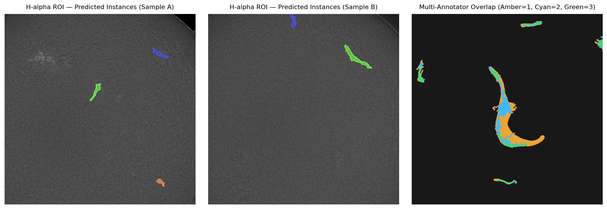
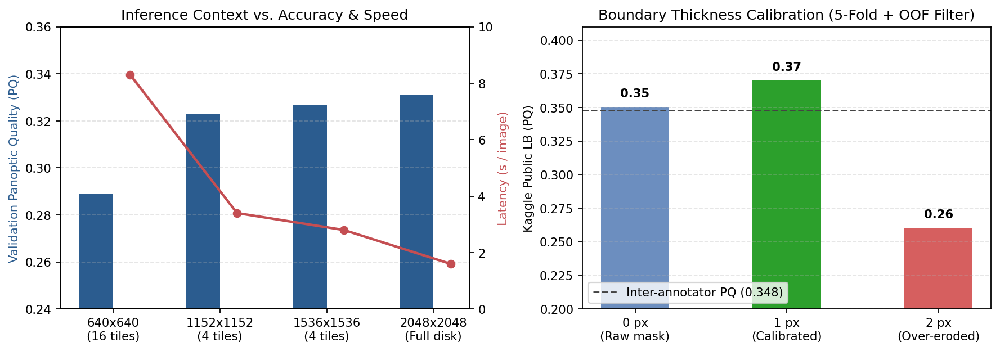

# Solar Filament Instance Segmentation in Full-Disk H-Alpha Observations

End-to-end training, evaluation, and full-disk inference pipeline for the **IEEE BigData Cup 2026 — Solar Filament Segmentation Challenge** (`MAGFiLO 1.0`, National Solar Observatory / GONG network).

Solar filaments are dense, cool plasma structures suspended in the solar chromosphere and corona along magnetic polarity inversion lines. Because filament destabilization is a primary precursor to coronal mass ejections (CMEs) and geomagnetic storms, accurate instance-level delineation on ground-based H-alpha imagery is critical for space weather forecasting.



---

## Problem Formulation and Dataset Challenges

The dataset comprises **707 unique full-disk GONG H-alpha observations** (`2048 x 2048` pixels, collected across six ground stations between 2011 and 2022) with **1,154 expert annotation sets** (`8,199` filament polygons) and **180 test observations**.

Submissions are scored with **pooled Panoptic Quality (PQ)** at strict instance matching threshold $\text{IoU} > 0.50$:

$$\text{PQ} = \underbrace{\frac{\sum_{(p, g) \in \text{TP}} \text{IoU}(p, g)}{|\text{TP}|}}_{\text{Segmentation Quality (SQ)}} \times \underbrace{\frac{|\text{TP}|}{|\text{TP}| + \frac{1}{2}|\text{FP}| + \frac{1}{2}|\text{FN}|}}_{\text{Recognition Quality (RQ)}}$$

Key domain and engineering challenges addressed in this repository:

1. **Thin, Elongated Geometry:** Filaments occupy `< 1%` of disk pixels and have a median width of ~11 pixels with narrow lateral barbs. A 1-pixel boundary bias shifts instance IoU enough to push borderline detections below the `0.50` matching cutoff.
2. **Inter-Annotator Disagreement:** Roughly 42% of training frames were labeled independently by two or three solar physicists. Evaluated against one another under the official pooled metric, **human-vs-human agreement is `PQ = 0.348`** (`SQ = 0.635`, `RQ = 0.548`).
3. **Observation Leakage Trap (`image_id` vs. `file_name`):** Multi-annotator observations appear multiple times in the COCO metadata under distinct `image_id` entries. Random splitting on `image_id` leaks the same physical observation across train and validation folds; all splits in [`dataset.py`](filament_seg/dataset.py) group strictly by `file_name`.
4. **Center-to-Limb Intensity Dropoff:** Solar limb darkening and atmospheric gradients vary across stations, degrading naive intensity thresholding near the limb.
5. **Zero-Overlap Constraint:** The evaluation server rejects any submission containing even a single overlapping pixel between two predicted instances on the same image.

---

## Methodology and Architecture

### 1. Full-Disk Preprocessing ([`preprocess.py`](filament_seg/preprocess.py))
Each `2048 x 2048` grayscale H-alpha frame is converted into a 3-channel `[0, 1]` tensor:
- **Channel 0:** On-disk 1st–99th percentile normalized intensity with off-disk background masked out.
- **Channel 1:** Local contrast enhancement via `16 x 16` tile CLAHE (`clipLimit=2.2`) to equalize center-to-limb variation.
- **Channel 2:** Normalized Sobel gradient magnitude highlighting filament spines and active-region boundaries.

### 2. Multi-Head Segmentation Backbones ([`model.py`](filament_seg/model.py))
Instead of predicting a single binary mask, each network predicts three structural channels simultaneously: **(1) soft annotator-mean mask**, **(2) morphological filament hull**, and **(3) filament spine**.

- **`EdgeAttResUNet3Head`:** ImageNet-initialized ResNet-34 encoder with a learned spatial edge branch gating a bottleneck Multi-Head Self-Attention block (`EdgeGuidedAttention`), decoded to full resolution via 5 skip stages.
- **`ConvNeXtAttUNet3Head`:** ConvNeXt-Tiny (`7 x 7` depthwise) encoder paired with an ASPP (`dilation = 1, 3, 6`) bridge and a dedicated stride-2 convolutional skip stem so 1–2 px barbs are not lost to the `4 x 4` patchify stem.
- **Loss Function:** Channel-weighted Binary Cross-Entropy + Soft Dice + recall-biased Tversky loss ($\alpha = 0.35, \beta = 0.65$) to penalize false negatives along fragmented filament tails.

### 3. Single-Pass 2048² Inference, Boundary Calibration, and OOF Filtering ([`inference.py`](filament_seg/inference.py), [`postprocess.py`](filament_seg/postprocess.py))
- **Uncropped Full-Disk Inference:** Although models are trained on `640 x 640` patches (`batch=3`, AMP), running inference on the entire `2048 x 2048` image in a single pass with 3x flip TTA eliminates tile-seam splits and reduces inference time from `8.3 s` to `1.6 s` per frame.
- **1 px Boundary Calibration:** Soft targets averaged across disagreeing annotators produce a ~1 px outer probability halo. Stripping 1 pixel after hysteresis/hull component extraction aligns predicted contours with expert polygon rasterization.
- **Learned OOF Candidate Filter:** Candidate instances extracted under permissive thresholds are scored using 19 geometric, multi-head probability, boundary-dropoff, and solar-disk radial ($\rho = r / R_{\odot}$) features via a 5-fold out-of-fold Random Forest classifier.

---

## Experiments and Results



### Reference Baselines on Training Set (707 Observations, Official Pooled Metric)

| Evaluation Scenario | Pooled PQ | SQ | RQ |
| :--- | :---: | :---: | :---: |
| Empty prediction | 0.000 | — | — |
| **Inter-annotator baseline** (human vs. human on multi-labeled frames) | **0.348** | 0.635 | 0.548 |
| Annotator pixel-mean oracle (`>= 0.5` connected components) | 0.790 | 0.891 | 0.887 |

### Inference Window Size Ablation (Fold 0 Validation)

| Inference Window | Grid Tiles | Thin-GT Val PQ | Latency / Image (RTX 4050) |
| :--- | :---: | :---: | :---: |
| `640 x 640` | 16 | 0.289 | 8.3 s |
| `1152 x 1152` | 4 | 0.323 | 3.4 s |
| `1536 x 1536` | 4 | 0.327 | 2.8 s |
| **`2048 x 2048` (Full disk)** | **1** | **0.331** | **1.6 s** |

### Progression and Kaggle Public Leaderboard Ablation

| Configuration | Active Images / Instances | Boundary Erosion | Public LB (PQ) |
| :--- | :---: | :---: | :---: |
| Single fold (`EdgeAttResUNet3Head`), 4-quadrant `1152²`, rule thresholds | 177 / 1,158 | 2 px | 0.31 |
| 2-model ensemble, 4-quadrant `1152²`, unfiltered | 178 / 1,292 | 1 px | 0.33 |
| 2-model ensemble + Full-disk `2048²` + Fold-0 FP filter (over-eroded) | 177 / 1,190 | 2 px | 0.26 |
| 5-Fold `EdgeAttResUNet3Head` + Full-disk `2048²` + 707-OOF FP filter | 176 / 1,064 | 0 px | 0.35 |
| **5-Fold `EdgeAttResUNet3Head` + Full-disk `2048²` + 707-OOF FP filter** | **176 / 1,064** | **1 px** | **0.37** |
| **Dual-Backbone (`ResNet34` + `ConvNeXt-Tiny ASPP`) + 707-OOF FP filter** | **177 / 1,057** | **1 px** | **0.37** |
| **10-Model Multi-Scale (`640² / 704² / 1024²`) Instance Clustering & Voting** | **177 / 1,114** | **1 px** | **0.37** |

Negative findings documented during experimentation:
- Training directly with eroded targets (`0.300` Val PQ) underperformed standard training followed by post-hoc 1 px erosion (`0.306` Val PQ).
- Ensembling raw probabilities across models trained with mismatched target thicknesses degraded boundary calibration (`0.223` Val PQ); instance-level clustering avoided this failure mode.
- Full 8x dihedral D4 TTA doubled inference runtime without improving PQ over 3x flip TTA (`0.318` vs. `0.319`).

---

## Repository Structure

```text
solar-filament-segmentation/
├── assets/
│   ├── prediction_comparison.png    # Side-by-side H-alpha ROI, expert labels, and OOF predictions
│   └── boundary_calibration.png     # Tile context & morphological boundary calibration ablations
├── filament_seg/
│   ├── __init__.py
│   ├── preprocess.py                # Disk normalization, CLAHE, and Sobel channel builder
│   ├── dataset.py                   # COCO parser, file_name fold splitter, and 3-head patch dataset
│   ├── model.py                     # EdgeAttResUNet3Head, ConvNeXtAttUNet3Head, and loss functions
│   ├── metrics.py                   # Cropped Mask structure and official pooled PQ evaluator
│   ├── rle.py                       # Dependency-free COCO RLE string encoder/decoder
│   ├── postprocess.py               # Instance extraction, erosion, and candidate FP features
│   ├── train.py                     # CLI training entrypoint
│   └── inference.py                 # CLI full-disk inference & submission generator
├── notebooks/
│   └── walkthrough.ipynb            # Clean interactive demo of preprocessing, splits, and PQ eval
├── pyproject.toml
├── requirements.txt
└── LICENSE
```

---

## Setup and Usage

### 1. Environment Installation

```bash
pip install -r requirements.txt
pip install -e .
```

### 2. Downloading the Dataset
Per competition rules, raw observations and annotations are not stored in this repository. Download the dataset via the official Kaggle CLI into `data/`:

```bash
kaggle competitions download -c filament-segmentation-2026 -p data/
unzip data/filament-segmentation-2026.zip -d data/MAGFiLO_1.0_Kaggle_2026
```

Expected layout:
```text
data/MAGFiLO_1.0_Kaggle_2026/
├── train/
│   ├── MAGFiLO_1.0_Annotations_kaggle2026_train.json
│   └── train_images/
└── test/
    └── test_images/
```

### 3. Training

Train a 5-fold `EdgeAttResUNet3Head` model (or switch `--arch convnext` for `ConvNeXtAttUNet3Head`):

```bash
python -m filament_seg.train \
    --data-dir data/MAGFiLO_1.0_Kaggle_2026 \
    --arch resnet34 \
    --fold 0 \
    --crop-size 640 \
    --batch 3 \
    --epochs 32 \
    --lr 4e-4 \
    --tversky 0.3 \
    --out runs/fold0
```

### 4. Full-Disk Inference

Generate a strictly non-overlapping COCO RLE `submission.csv` from one or more checkpoints:

```bash
python -m filament_seg.inference \
    --images data/MAGFiLO_1.0_Kaggle_2026/test/test_images \
    --weights runs/fold0/best.pt runs/fold1/best.pt runs/fold2/best.pt runs/fold3/best.pt runs/fold4/best.pt \
    --tile 2048 \
    --erode 1 \
    --out outputs/submission.csv
```

---

## License

Released under the [MIT License](LICENSE). Dataset imagery and annotations remain subject to the terms set by the National Solar Observatory (NSO) and IEEE BigData Cup organizers.
